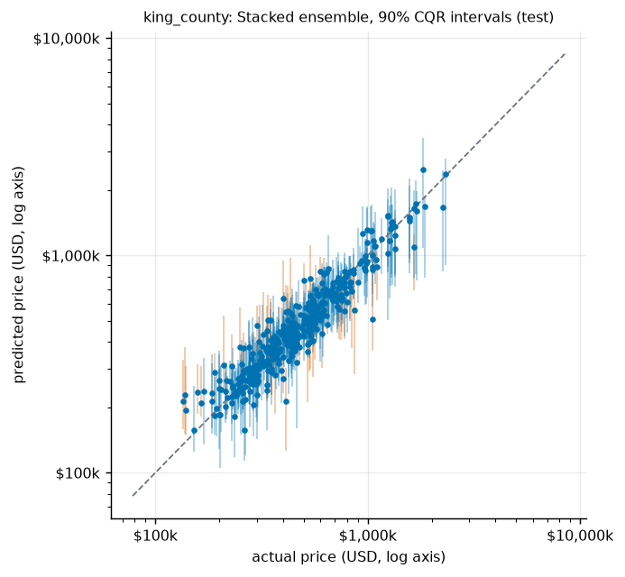
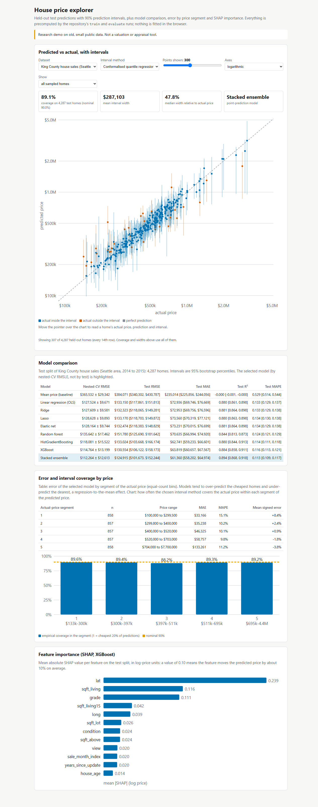
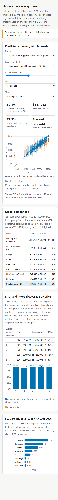
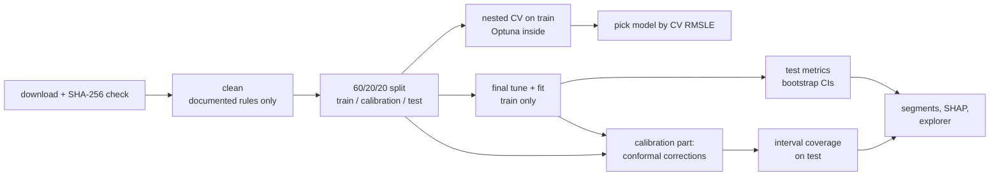
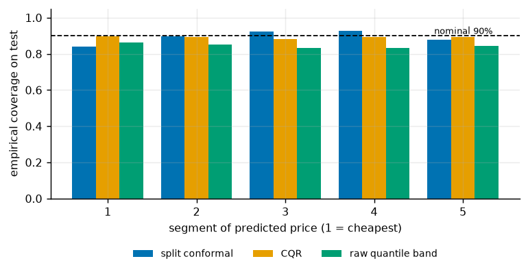
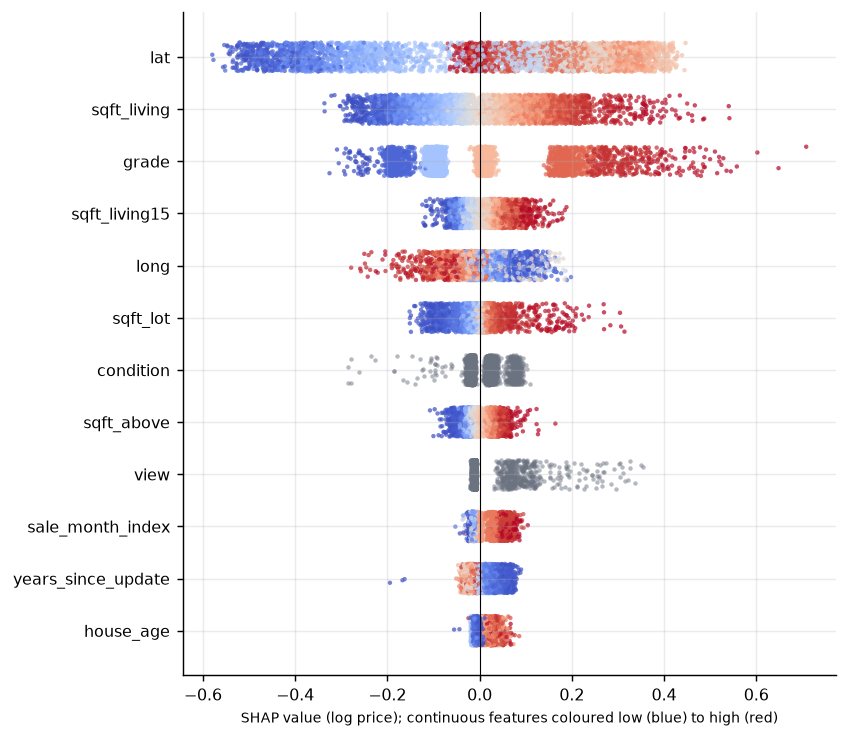
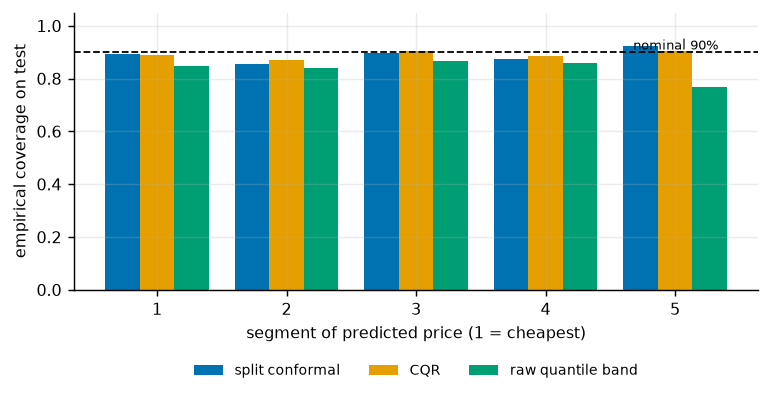
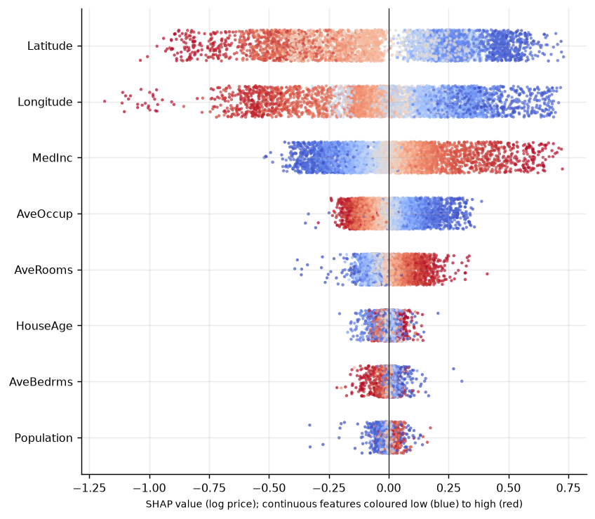

# Housing price regression: nested CV, stacking, log targets and checked prediction intervals

[](https://creativecommons.org/licenses/by-nc-nd/4.0/)
[](.github/workflows/ci.yml)

## Summary

| | King County house sales (21,435 sales, 2014 to 2015) | California Housing (20,640 block groups, 1990) |
|---|---|---|
| Train / calibration / test rows | 12,861 / 4,287 / 4,287 | 12,384 / 4,128 / 4,128 |
| Model chosen by nested CV (test split unused) | Stacked ensemble | Stacked ensemble |
| Test RMSE of the chosen model, USD (95% CI) | 124,915 [101,673, 152,244] | 47,074 [44,775, 49,466] |
| Test R2 / MAPE of the chosen model | 0.894 / 0.113 | 0.832 / 0.161 |
| Mean-price baseline RMSE, USD | 384,071 | 114,878 |
| Ridge RMSE, USD (95% CI) | 132,323 [118,065, 149,281] | 67,934 [65,557, 70,485] |
| XGBoost RMSE, USD (95% CI) | 130,554 [106,122, 158,173] | 48,005 [45,656, 50,544] |
| Coverage of 90% intervals on the test split: split conformal / CQR / raw quantile band | 0.894 / 0.891 / 0.844 | 0.889 / 0.891 / 0.837 |
| Status of every figure in this table | Verified (run 2026-10-15, seed 42) | Verified (run 2026-10-15, seed 42) |

Findings, each backed by the tables below (status: Verified (run 2026-10-15, seed 42)):

- **King County: the models agree on dollars and differ on percentages.** Dollar RMSE is dominated by a few very expensive homes (the dearest fifth of the test split has an RMSE of 248,555), so its differences are within noise: stack minus ridge is -7,408 [-21,628, +7,730]. On MAE, MAPE and RMSLE the gradient-boosted models and the stack are clearly better than the linear models (MAPE 0.113 [0.109, 0.117] for the stack against 0.133 [0.129, 0.138] for ridge). The stack beats XGBoost on RMSE by -5,640 [-11,237, -1,713].
- **California: trees win clearly.** Ridge is no better than OLS, and the tree models cut RMSE by about 20,000 dollars (stack minus ridge -20,860 [-22,753, -19,030]); latitude and longitude carry the most SHAP weight, and location effects are likely non-linear (not tested separately). The stack beats XGBoost by a small but real margin (-931 [-1,577, -447]).
- **Log target:** it makes ridge workable (a raw-price ridge predicts a non-positive price for 39 King County and 42 California test homes) and lowers percentage error, but for boosting the dollar RMSE is the same or slightly lower with the raw target (California XGBoost 46,566 raw against 48,005 log; King County 130,606 against 130,554).
- **Intervals:** both conformal methods land near the nominal 90% on held-out homes (split conformal 0.894 and 0.889, CQR 0.891 and 0.891); the raw 5%/95% quantile band covers less (0.844 and 0.837). CQR's coverage is more even across predicted-price segments on King County (0.882 to 0.896 against 0.840 to 0.928 for split conformal); on California both vary (0.869 to 0.906 and 0.857 to 0.923).
- **Error by price:** cheap homes are over-predicted and the dearest under-predicted (+8.4% and -3.8% in the extreme King County segments, +19.9% and -9.1% on California), the usual regression-to-the-mean pattern.

**Not a valuation tool.** The data are from 2014 to 2015 (King County) and 1990 (California). Everything here comes from committed runs: `docs/runs/`.



## Overview

Two public housing datasets, one methodology: strong baselines first (mean price, linear), then regularised linear models, a random forest, gradient boosting and a stacked ensemble, all trained on log(price). Tuning happens inside nested cross-validation, the test split is touched once, intervals are conformalised and their coverage is checked on held-out homes, and the errors are broken down by price segment.

## Demo

`docs/index.html` is a static page (no server, no network): predicted vs actual price with 90% intervals for the held-out homes of either dataset, a choice of interval method, model comparison with bootstrap intervals, error and coverage by price segment, and SHAP importance. Checked with Playwright at 390 px and 1280 px with no console errors.

| 1280 px | 390 px |
|---|---|
|  |  |

## Problem statement

Predict a home's sale price (King County) or a block group's median house value (California) from its features, report the error honestly, and give a prediction interval whose coverage is verified rather than assumed.

## Approach



- **Baselines:** the training-set mean price, and ordinary least squares.
- **Regularised linear:** ridge, lasso, elastic net on standardised, one-hot features with missing-value indicators and log1p of skewed columns (columns chosen from training rows only).
- **Trees:** random forest, HistGradientBoosting and XGBoost on ordinal-coded categories (one column per original feature).
- **Stacked ensemble:** ridge, random forest, HistGradientBoosting and XGBoost (each with the parameters tuned in the same fold) combined by a non-negative linear model fitted on 5-fold out-of-fold predictions.
- **Log target:** all models except the mean baseline are trained on log(price) and exponentiated, so errors are multiplicative and predictions stay positive. A raw-price ablation with the same tuned parameters is reported.
- **Tuning:** Optuna TPE, seeded per fold, minimising inner-CV RMSLE (RMSE of log price). 15 trials per model and fold, 3 inner folds, 5 outer folds.
- **Intervals (90%):** (a) split conformal on log-price residuals; (b) conformalised quantile regression (CQR) around 5% and 95% gradient-boosted quantile models; (c) the raw quantile band without correction, as a contrast. The calibration part (20% of rows) is never used for fitting or tuning.
- **Explanations:** SHAP on the XGBoost model, in log-price units.

## Data

| | King County house sales | California Housing |
|---|---|---|
| Source | Kaggle `harlfoxem/housesalesprediction`, no-login copy on OpenML (dataset 42092) | Pace and Barry (1997) via StatLib and scikit-learn |
| Rows | 21,613 sales (May 2014 to May 2015); 21,435 after the cleaning rules below | 20,640 census block groups (1990) |
| Features | 18 original (area, grade, condition, view, waterfront, year built, location, zip code, neighbours' lot and living area) plus 5 derived | 8 numeric |
| Target | sale price, USD (75,000 to 7,700,000) | median house value, USD, capped at 500,001 |
| Licence | **CC0 1.0 (public domain)**, verified at the Kaggle and OpenML records (evidence in `THIRD_PARTY_NOTICES.md`) | none stated; U.S. Census-derived |
| Download | `house_sales.arff`, SHA-256 pinned | `cal_housing.tgz`, SHA-256 pinned (same as scikit-learn's) |

Nothing is committed except small derived results and per-home test predictions in the explorer. Licence details and exact attributions are in `THIRD_PARTY_NOTICES.md`.

Cleaning rules, all fixed in advance and row-wise (so they cannot leak): King County keeps only the latest sale of each house `id` (177 earlier sales of repeat-sold houses are dropped, so the same house cannot sit in both the training and the test split) and drops one record with 33 bedrooms in 1,620 sq ft; `id` and `date` are replaced by `sale_month_index`, `house_age`, `years_since_update`, `was_renovated` and `has_basement`; `zipcode` is a category. There are no missing values in either dataset; the imputers are still fitted inside each training fold.

## Results

All numbers are from `docs/runs/2026-10-15-king_county-run.md` and `docs/runs/2026-10-15-california-run.md` (seed 42, run on 2026-10-15) and `results/<dataset>/*.json`. Status of every table below: Verified (run 2026-10-15, seed 42). Intervals are 95% bootstrap percentile intervals over the test rows (1,000 resamples).

### King County, hold-out test split

| Model | RMSE ($) | MAE ($) | R2 | MAPE |
|---|---|---|---|---|
| Mean price (baseline) | 384,071 [340,302, 430,787] | 235,014 [225,856, 244,056] | -0.000 [-0.001, -0.000] | 0.529 [0.514, 0.544] |
| Linear regression (OLS) | 133,150 [117,861, 151,813] | 72,936 [69,746, 76,669] | 0.880 [0.861, 0.898] | 0.133 [0.129, 0.137] |
| Ridge | 132,323 [118,065, 149,281] | 72,953 [69,756, 76,596] | 0.881 [0.864, 0.898] | 0.133 [0.129, 0.138] |
| Lasso | 133,170 [118,703, 149,872] | 73,560 [70,319, 77,121] | 0.880 [0.863, 0.898] | 0.134 [0.130, 0.138] |
| Elastic net | 132,474 [118,383, 148,829] | 73,231 [70,015, 76,699] | 0.881 [0.864, 0.898] | 0.134 [0.129, 0.138] |
| Random forest | 151,780 [125,690, 181,642] | 70,635 [66,994, 74,920] | 0.844 [0.813, 0.873] | 0.124 [0.121, 0.129] |
| HistGradientBoosting | 133,024 [103,668, 166,174] | 62,741 [59,233, 66,601] | 0.880 [0.844, 0.913] | 0.114 [0.111, 0.118] |
| XGBoost | 130,554 [106,122, 158,173] | 63,819 [60,657, 67,567] | 0.884 [0.858, 0.911] | 0.116 [0.113, 0.121] |
| Stacked ensemble | 124,915 [101,673, 152,244] | 61,360 [58,202, 64,974] | 0.894 [0.868, 0.918] | 0.113 [0.109, 0.117] |

Nested CV on the training rows (mean +/- sd over 5 outer folds):

| Model | RMSE ($) | MAE ($) | R2 | RMSLE | MAPE |
|---|---|---|---|---|---|
| Mean price (baseline) | 365,532 +/- 29,342 | 233,986 | -0.001 | 0.546 | 0.532 |
| Linear regression (OLS) | 127,524 +/- 9,671 | 72,223 | 0.877 | 0.177 | 0.133 |
| Ridge | 127,609 +/- 9,581 | 72,285 | 0.877 | 0.177 | 0.133 |
| Lasso | 128,628 +/- 9,893 | 72,862 | 0.875 | 0.178 | 0.134 |
| Elastic net | 128,164 +/- 9,744 | 72,617 | 0.876 | 0.177 | 0.133 |
| Random forest | 135,642 +/- 17,462 | 70,253 | 0.863 | 0.174 | 0.125 |
| HistGradientBoosting | 118,081 +/- 15,522 | 64,219 | 0.896 | 0.161 | 0.118 |
| XGBoost | 114,764 +/- 13,199 | 63,275 | 0.901 | 0.160 | 0.116 |
| Stacked ensemble | 112,264 +/- 12,613 | 62,224 | 0.906 | 0.157 | 0.115 |

Paired test-RMSE differences (negative means the first model is better):

- stack minus ridge: -7,408 [-21,628, +7,730]
- stack minus ols: -8,235 [-21,764, +6,646]
- stack minus xgb: -5,640 [-11,237, -1,713]
- stack minus hgb: -8,109 [-14,365, -1,576]
- xgb minus ridge: -1,768 [-17,886, +17,501]

Log target against raw target, same tuned parameters:

| Model | RMSE ($), log / raw target | RMSLE, log / raw | MAPE, log / raw | non-positive raw predictions |
|---|---|---|---|---|
| Ridge | 132,323 / 194,124 | 0.180 / 1.214 | 0.133 / 0.215 | 39 |
| Random forest | 151,780 / 139,932 | 0.176 / 0.175 | 0.124 / 0.128 | 0 |
| HistGradientBoosting | 133,024 / 142,958 | 0.160 / 0.166 | 0.114 / 0.120 | 0 |
| XGBoost | 130,554 / 130,606 | 0.161 / 0.167 | 0.116 / 0.123 | 0 |

Error by segment of the actual price (Stacked ensemble, test split):

| Segment of actual price | n | price range ($) | MAE ($) | MAPE | mean signed error |
|---|---|---|---|---|---|
| 1 | 858 | 100,000 to 299,500 | 33,166 | 0.151 | +8.4% |
| 2 | 857 | 299,800 to 400,000 | 35,238 | 0.102 | +2.4% |
| 3 | 857 | 400,000 to 520,000 | 46,325 | 0.101 | +0.9% |
| 4 | 857 | 520,000 to 703,000 | 58,757 | 0.098 | -1.8% |
| 5 | 858 | 704,000 to 7,700,000 | 133,261 | 0.112 | -3.8% |

Prediction intervals:

| Method | test coverage | mean width ($) | median width / price | coverage over 200 re-drawn calibration sets: mean (5th to 95th pct) |
|---|---|---|---|---|
| Split conformal (log scale) | 0.894 | 258,353 | 0.481 | 0.901 (0.888 to 0.910) |
| Conformalised quantile regression | 0.891 | 287,103 | 0.478 | 0.900 (0.888 to 0.909) |
| Raw 5%/95% quantile band, no correction | 0.844 | 256,586 | 0.420 | n/a |

Coverage by segment of the **predicted** price (1 = cheapest 20% of predictions):

| Method | 1 | 2 | 3 | 4 | 5 |
|---|---|---|---|---|---|
| Split conformal | 0.840 | 0.898 | 0.925 | 0.928 | 0.876 |
| CQR | 0.896 | 0.894 | 0.882 | 0.893 | 0.892 |
| Raw band | 0.864 | 0.851 | 0.831 | 0.833 | 0.844 |





### California, hold-out test split

| Model | RMSE ($) | MAE ($) | R2 | MAPE |
|---|---|---|---|---|
| Mean price (baseline) | 114,878 [112,253, 117,619] | 90,909 [88,854, 93,101] | -0.000 [-0.001, -0.000] | 0.630 [0.605, 0.654] |
| Linear regression (OLS) | 67,932 [65,557, 70,484] | 46,634 [45,248, 48,185] | 0.650 [0.628, 0.674] | 0.257 [0.246, 0.269] |
| Ridge | 67,934 [65,557, 70,485] | 46,635 [45,249, 48,186] | 0.650 [0.628, 0.674] | 0.257 [0.246, 0.269] |
| Lasso | 67,940 [65,555, 70,489] | 46,641 [45,255, 48,190] | 0.650 [0.628, 0.673] | 0.257 [0.246, 0.269] |
| Elastic net | 67,938 [65,556, 70,488] | 46,639 [45,253, 48,189] | 0.650 [0.628, 0.673] | 0.257 [0.246, 0.269] |
| Random forest | 51,843 [49,551, 54,301] | 33,035 [31,833, 34,330] | 0.796 [0.779, 0.813] | 0.179 [0.169, 0.191] |
| HistGradientBoosting | 47,721 [45,478, 50,067] | 30,504 [29,412, 31,715] | 0.827 [0.811, 0.843] | 0.165 [0.155, 0.178] |
| XGBoost | 48,005 [45,656, 50,544] | 30,505 [29,488, 31,734] | 0.825 [0.807, 0.842] | 0.164 [0.154, 0.175] |
| Stacked ensemble | 47,074 [44,775, 49,466] | 29,904 [28,846, 31,082] | 0.832 [0.816, 0.847] | 0.161 [0.151, 0.173] |

Nested CV on the training rows (mean +/- sd over 5 outer folds):

| Model | RMSE ($) | MAE ($) | R2 | RMSLE | MAPE |
|---|---|---|---|---|---|
| Mean price (baseline) | 115,701 +/- 1,398 | 91,345 | -0.000 | 0.590 | 0.621 |
| Linear regression (OLS) | 66,852 +/- 1,343 | 46,056 | 0.666 | 0.321 | 0.248 |
| Ridge | 66,862 +/- 1,342 | 46,064 | 0.666 | 0.321 | 0.249 |
| Lasso | 66,869 +/- 1,339 | 46,069 | 0.666 | 0.321 | 0.249 |
| Elastic net | 66,865 +/- 1,341 | 46,065 | 0.666 | 0.321 | 0.249 |
| Random forest | 51,567 +/- 1,161 | 32,797 | 0.801 | 0.235 | 0.170 |
| HistGradientBoosting | 47,443 +/- 1,637 | 30,418 | 0.831 | 0.224 | 0.160 |
| XGBoost | 47,041 +/- 1,742 | 29,920 | 0.834 | 0.219 | 0.156 |
| Stacked ensemble | 46,493 +/- 1,640 | 29,581 | 0.838 | 0.217 | 0.154 |

Paired test-RMSE differences (negative means the first model is better):

- stack minus ridge: -20,860 [-22,753, -19,030]
- stack minus ols: -20,858 [-22,752, -19,028]
- stack minus xgb: -931 [-1,577, -447]
- stack minus hgb: -647 [-1,148, -97]
- xgb minus ridge: -19,929 [-22,018, -17,830]

Log target against raw target, same tuned parameters:

| Model | RMSE ($), log / raw target | RMSLE, log / raw | MAPE, log / raw | non-positive raw predictions |
|---|---|---|---|---|
| Ridge | 67,934 / 71,328 | 0.331 / 1.222 | 0.257 / 0.329 | 42 |
| Random forest | 51,843 / 51,610 | 0.246 / 0.259 | 0.179 / 0.201 | 0 |
| HistGradientBoosting | 47,721 / 46,761 | 0.229 / 0.236 | 0.165 / 0.177 | 0 |
| XGBoost | 48,005 / 46,566 | 0.228 / 0.237 | 0.164 / 0.178 | 0 |

Error by segment of the actual price (Stacked ensemble, test split):

| Segment of actual price | n | price range ($) | MAE ($) | MAPE | mean signed error |
|---|---|---|---|---|---|
| 1 | 826 | 14,999 to 107,100 | 15,915 | 0.245 | +19.9% |
| 2 | 825 | 107,300 to 157,300 | 20,235 | 0.153 | +5.3% |
| 3 | 826 | 157,300 to 209,400 | 23,151 | 0.128 | +1.7% |
| 4 | 825 | 209,400 to 289,900 | 31,560 | 0.129 | -2.2% |
| 5 | 826 | 290,000 to 500,001 | 58,648 | 0.148 | -9.1% |

Prediction intervals:

| Method | test coverage | mean width ($) | median width / price | coverage over 200 re-drawn calibration sets: mean (5th to 95th pct) |
|---|---|---|---|---|
| Split conformal (log scale) | 0.889 | 128,278 | 0.640 | 0.901 (0.890 to 0.911) |
| Conformalised quantile regression | 0.891 | 147,092 | 0.725 | 0.900 (0.889 to 0.910) |
| Raw 5%/95% quantile band, no correction | 0.837 | 133,604 | 0.656 | n/a |

Coverage by segment of the **predicted** price (1 = cheapest 20% of predictions):

| Method | 1 | 2 | 3 | 4 | 5 |
|---|---|---|---|---|---|
| Split conformal | 0.892 | 0.857 | 0.898 | 0.875 | 0.923 |
| CQR | 0.890 | 0.869 | 0.906 | 0.885 | 0.903 |
| Raw band | 0.849 | 0.840 | 0.866 | 0.859 | 0.770 |





### What the explanations say

SHAP values are in log-price units. On King County the largest effects come from `lat` (location), `sqft_living` and `grade`; on California from `Latitude`, `Longitude` and `MedInc`. These are associations learned by the model, not causal effects.

## Tech stack

Python 3.11, scikit-learn 1.9, XGBoost 3.2, Optuna 5.0, SHAP 0.51, pandas 3.0, matplotlib, pytest, ruff. Exact versions are pinned in `requirements.txt`.

## Getting started

Prerequisites: Python 3.11 and git. No GPU.

```bash
git clone https://github.com/Janeferdinant/housing-price-regression.git
cd housing-price-regression
python -m venv .venv && source .venv/bin/activate      # Windows: .venv\Scripts\activate
python -m pip install -r requirements.txt
python -m pip install -e .

python -m pytest -m "not slow"                         # fast tests (about 40 seconds)
house-price train --dataset king_county --jobs 5       # downloads the data; nested CV and final fits (about 15 minutes on 16 CPUs)
house-price evaluate --dataset king_county             # test metrics, intervals, segments, SHAP, figures, run log
house-price train --dataset california --jobs 5        # about 10 minutes on 16 CPUs
house-price evaluate --dataset california
python scripts/build_explorer.py                       # writes docs/index.html
```

Quick smoke setting (about 2 minutes in total, rough numbers): add `--trials 3 --splits 3 --inner-splits 2 --models mean ridge hgb xgb` to `train` and `--bootstrap 100` to `evaluate`.

Predict with the trained model; the input needs the dataset's raw feature columns (for King County, the OpenML columns without `id` and `price`, with `date` as `YYYY-MM-DD`):

```bash
house-price predict --dataset california --input examples/california_sample.csv
house-price predict --dataset king_county --input examples/king_county_sample.csv
```

The output has `predicted_price`, `lower`, `upper` (a 90% interval, CQR by default; `--method split_conformal` for the other), the model name, and a reminder on stderr that this is not an appraisal.

## Project structure

```
src/house_price/   data, splits, preprocess, models, tuning, conformal, metrics, explain, plots, pipeline, cli
tests/             pytest: cleaning and checksums, splits, preprocessing, models, metrics, conformal coverage, leakage, CLI
scripts/           build_explorer.py and its HTML template
results/<dataset>/ small derived JSON/CSV from the committed runs
docs/runs/         dated run logs (seeds, hardware, library versions, tables)
docs/index.html    static explorer
docs/img/          figures used in this README
examples/          made-up inputs for the predict command
```

## Real-world applications

Automated valuation models give lenders, insurers and tax assessors a price estimate and a range around it. The lesson that transfers is the interval: a range whose coverage has been measured on held-out data, and a breakdown showing where the model is least reliable (here the cheapest and the dearest homes). This repository is a methodology study, not a product.

## Limitations

- **Old and narrow.** California is 1990 census data with a capped target (965 block groups, 4.7%, sit at the 500,001 cap, so the dearest segment is censored). King County is one year of sales (May 2014 to May 2015) in one metropolitan area. Neither describes today's markets.
- **Not an appraisal.** California values are block-group medians, not individual homes; error sizes do not transfer. King County has no information about interior finish beyond a grade and a condition score.
- **One split.** Metrics come from one random 60/20/20 split per dataset (seed 42). Bootstrap intervals cover test-row sampling, not the choice of split. The nested-CV spread shows split-to-split variation on the training part.
- **Intervals.** Split conformal guarantees marginal coverage only on average over calibration draws, not per segment or per home. Coverage by price segment is reported and varies; the 200 re-drawn calibration sets show the spread of realised coverage.
- **Log-target retransformation.** Exponentiating a log-scale prediction gives a median-type estimate, not a mean; no smearing correction is applied.
- **Neighbour features.** King County's `sqft_living15` and `sqft_lot15` describe the 15 nearest neighbours as recorded in the dataset; how they were computed (and whether they use sales after the one being predicted) is not documented, so they may carry some information that would not be available at prediction time.
- **Time box.** Search budgets are modest (15 trials per model and fold) to fit a 25-minute CPU limit; lasso and elastic net can fail to converge fully at very small penalties (scikit-learn warns); they are still fitted and scored as they stand.
- **California licence.** No licence statement was found for the StatLib file; it derives from U.S. Census statistics and is cited as such.

## Future scope

- Repeat with several split seeds and report the spread of the model ranking.
- Add spatial cross-validation (blocks of latitude and longitude) to test the effect of spatial leakage, and a time-based split on King County (train on earlier months).
- Locally adaptive conformal intervals (normalised residuals) to improve per-segment coverage.
- A smearing correction for the log target and a comparison of mean against median predictions.

## Credits & citation

- King County house sales: Kaggle user `harlfoxem`, CC0 1.0, via OpenML dataset 42092.
- Pace, R. K. and Barry, R. (1997). Sparse Spatial Autoregressions. *Statistics and Probability Letters*, 33, 291 to 297.
- Romano, Y., Patterson, E. and Candes, E. (2019). Conformalized Quantile Regression. NeurIPS.

Libraries are listed in `THIRD_PARTY_NOTICES.md`.

## License

Original work © Jane Rose Ferdinant, licensed CC BY-NC-ND 4.0. Third-party components retain their own licenses; see THIRD_PARTY_NOTICES.md.

## Author

Jane Rose Ferdinant: [portfolio](https://janeferdinant.vercel.app) and [LinkedIn](https://www.linkedin.com/in/janerosenf/).
